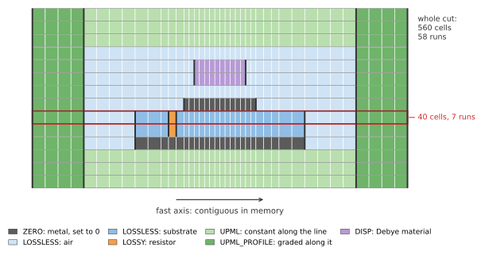
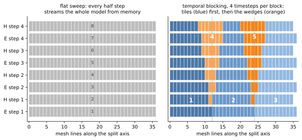
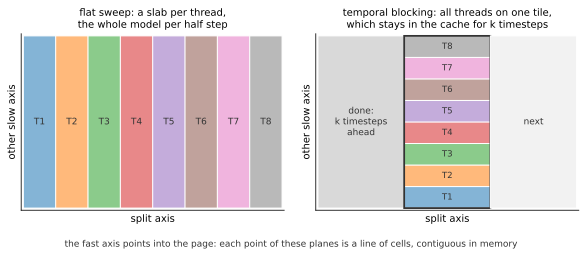

.. _engine_cpu_internals:

CPU Engine Internals
====================

The CPU engine (``--engine=cpu``, see :ref:`concept_engine_cpu`) computes the
same FDTD update as the default engine, but it is built around the one thing
that limits an FDTD solver on a CPU: moving the fields between the memory and
the cores. This page explains how: what it stores per cell, how it advances
several timesteps while the data is in the cache, and how it keeps the cores
busy. None of it needs any setting; the last section shows how to see what
the engine chose for a model.

Where the time goes
-------------------

The FDTD update of a cell is a handful of multiplications and additions on
its field and the fields of its neighbours, see :ref:`concept_numerical_method`.
A core does that in a few nanoseconds; loading the values from the main
memory takes longer. Each timestep reads and writes the three electric and
the three magnetic field components of every cell, 24 bytes each way in single
precision, plus whatever the update needs besides: the coefficients, the
state of a PML or a dispersive material. Once a model no longer fits into the
cache, its speed is the memory bandwidth divided by these bytes per cell,
whatever the cores could compute.

So there are two ways to be faster: fewer bytes per cell, and each byte loaded
from memory used for more than one timestep. The CPU engine does both. The
table shows how far each step goes on the ``antenna`` case of the
:ref:`speed benchmark <benchmark>` (size M, 7.9 million cells: a patch with a
lumped port, a Debye material, an 8-cell PML and field dumps) on the 8 cores
of a Ryzen 7 5800X:

.. list-table::
   :header-rows: 1
   :widths: 60 20 20

   * - Engine
     - MC/s
     - Speed-up
   * - default engine (``multithreaded``)
     - 167
     - 1.0
   * - CPU engine, without temporal blocking (``OPENEMS_CPU_TBLOCK=0``)
     - 397
     - 2.4
   * - CPU engine, temporal blocking, generic kernels (``OPENEMS_CPU_ISA=generic``)
     - 1192
     - 7.1
   * - CPU engine, temporal blocking, AVX2 kernels (the default)
     - 1344
     - 8.0

The last line is more than the main memory can deliver: 1344 million cells
per second with 48 bytes of fields each are 64 GB/s, more than the 51 GB/s
of dual-channel DDR4-3200. Most of these bytes come from the cache.

.. _engine_cpu_runs:

Cell runs
---------

The default engine stores the update coefficients of every cell and reads
them along with the fields, in its compressed form as an index per cell into
a table of the distinct coefficients. On a graded mesh almost every cell is
distinct, because the coefficients contain the cell size, so the table grows
large.

The CPU engine splits each coefficient into a material part and a mesh part.
The mesh part is the product of a factor per mesh line and axis, e.g. the
length of an edge over the area of the face around it, so it is kept in three
small tables, one value per mesh line. The material part depends only on the
material, and the coefficient is their product, computed in the update. What
is left per cell is its *class* and its material, and neighbouring cells along
a line usually share both. The engine stores each line of the mesh as a few
*runs*: a start, a stop and a set of coefficients for all the cells between.

The figure is a cut through a patch antenna. The 40 cells of the marked line
are 7 runs; the whole cut, 560 cells, has 58. The mesh is graded around the
patch, but that does not break a run. The classes are:

ZERO
   Metal, and the outer lines where a field is always zero. The run is set to
   zero, nothing is read.
LOSSLESS
   Air, a lossless dielectric: the field plus the curl times a coefficient.
LOSSY
   A conductivity, e.g. a lumped resistor: the old field is scaled first.
UPML, UPML_PROFILE
   The PML, see the :ref:`PML boundary <concept_bc_pml>`. In a PML the update keeps a second
   value per cell, the flux. The default engine updates it in a separate pass
   before and after the main update; here it is part of the same pass. A PML
   normal to the line has coefficients that change from cell to cell; such a
   run reads them from a short profile, which all lines through the PML share.
DISP
   A Drude, Lorentz or Debye material, see :ref:`dispersive_materials`. Its
   auxiliary currents and states are updated in the same pass as the field as
   well, instead of in passes of their own over a list of cells.

Each class is a small loop of its own, so the loop for air does not test for
PML or dispersive cells, and the compiler can vectorise it. Because the PML
and the dispersive materials are updated in one pass with the field, their
cells are read once per half step instead of three times.

The engine chooses the axis of the runs per model: the one along which the
cells form the fewest runs. This *fast axis* is also the axis that is
contiguous in memory. The fields are in that layout as well, so a run is a
contiguous range of memory.

One more saving: the magnetic field inside solid metal is computed from
electric fields that are all zero, so it never changes. These cells are in no
run and the engine skips them. In a model of a milled waveguide block, that is
most of the magnetic field.

``--debug-operator`` writes the cell model to ``cellmodel_dump.h5``: the
class, coefficient set and run length of every edge, to check what the engine
made of a structure.

Kernels
-------

The update loops are compiled twice: once for any CPU of the architecture
(SSE2 on x86-64, NEON on ARM64), and once for AVX2 with FMA on x86-64. The
engine picks the AVX2 kernels when the CPU has them. As the table above shows,
this only pays once the data comes from the cache: without temporal blocking
both are equally fast, they wait for the memory alike.

.. _engine_cpu_blocking:

Temporal blocking
-----------------

The update of a timestep needs the neighbours of a cell, so one timestep has
to be finished across the whole model before the next can start: this is
the *flat sweep*. A model larger than the cache is loaded from memory twice
per timestep, once for the electric and once for the magnetic field.

But a cell only needs its direct neighbours, not the whole model. The
electric field at a mesh line needs the magnetic field of the half step
before at that line and the line below it; the magnetic field then needs the
electric field at its line and the line above. So a block of lines can be
advanced by a timestep without the rest of the model, if it shrinks by a line
on each side every timestep: the lines at its edges lack the neighbours from
outside. After *k* timesteps it is a trapezoid in space and time. Temporal
blocking cuts the model into tiles that fit into the cache and advances each
by *k* timesteps while it is there:

On the left, the flat sweep: each half step goes over all 36 lines, eight
times through the model for four timesteps. On the right, temporal blocking
with four timesteps per block: tile 1 is loaded and advanced as far as it can
go, then tile 2, then tile 3, each a trapezoid. The triangles between them,
the *wedges* 4 and 5, are what the shrinking left behind; by now their
neighbours on both sides are complete, so they can be filled in. Each tile is
loaded from memory once for its four timesteps, and the wedges are small. The
memory traffic drops by almost the factor *k*.

The engine uses up to 8 timesteps per block. The tiles are cut along the
*split axis*, the slow axis with more mesh lines. Each tile spans the full
model along the other two axes, and the tile width, in mesh lines along the
split axis, is what makes it fit into the cache.

All threads work on the same tile. Each takes a strip of it along the other
slow axis and keeps it in its share of the cache through the timesteps of the
block:

Each half step of a trapezoid or a wedge is a *phase*. The threads finish a
phase together before the next starts, as the next one reads the strips of
their neighbours. In the example below that is several thousand times per
second; the section on threads shows how it stays cheap.

Every cell is updated exactly once per half step, with its neighbours at the
right time, just in a different order; the result does not depend on whether
the engine blocked or not.

The engine's extensions, the excitation, lumped elements, Mur and local
absorbing boundaries, TF/SF, the steady-state detection and a closed
cylindrical mesh, run inside the blocks, each on the part of the model the
phase updates. Probes and field dumps need the fields at a certain timestep:
a block ends there, and they read the fields between two blocks.

The engine falls back to the flat sweep, and says why at ``--verbose=1``, if

- the model fits into the cache anyway, or a single plane of it does not;
- the mesh is a cylindrical multi-grid (see :ref:`concept_cylindrical_fdtd`);
- local absorbing boundaries are oriented along different axes.

Choosing the tile
-----------------

A tile should fill most of the last-level cache that the threads share, but
not all of it: the rest of the program needs some too, and a tile that fills
the whole cache is evicted and much slower. The engine estimates the bytes of
a mesh plane, fields, PML and material state together, and the cache the
threads span. From that it takes the number of timesteps and a tile width of
3/4 of what fits.

Caches are not that simple, so the engine also tries other widths: four and two
times as wide, half and a quarter. During the first seconds of the run it
times each for 0.5 s, from the estimate in the direction that gets faster,
then the flat sweep, and keeps the fastest. The trials are timesteps of the
simulation like any other, so they cost only the difference in speed. With ``--verbose=1``
the engine shows all of it, here for the ``antenna`` case above:

.. code-block:: text

    Engine_CPU: fast axis y, layout NKIJ
    Engine_CPU: kernels for avx2
    Engine_CPU: cache 32 MiB, L3 (sysconf), 1 of 1 such caches for 8 threads
    Engine_CPU: temporal blocking, up to 8 timesteps per block, tiles of 18 lines along z, 326 phases
    Engine_CPU: tiles to try (timesteps:lines) 1) 8:72 2) 8:36 3) 8:18 4) 4:9, and the flat sweep, 0.5 s each
    Multithreaded engine: tried tile 2 800.6 MC/s tile 3 1339.3 MC/s tile 4 1017.8 MC/s, flat 396.4 MC/s; running tile 3

The estimate (tile 3, 8 timesteps on 18 lines) was the fastest; half as wide
loses a quarter, twice as wide 40 %.

Threads
-------

By default the engine runs a thread per physical core. A second thread on
the same core (SMT, hyper-threading) adds no memory bandwidth and no cache,
it only splits them further. ``--numThreads`` sets another number.

A thread that finishes its part of a phase first spins for about 30 µs: the
others are usually done by then, and it can go on at once. Then it yields the
core for a while, and only after 10 ms it goes to sleep. Waking a sleeping
thread takes far longer than a phase of a small model; this alone makes small
models up to twice as fast, in all engines of openEMS.

Field dumps
-----------

A field dump interpolates the fields from the edges of the cells to the mesh
nodes. The CPU engine computes the weights of this interpolation once, at the
start, as a table per dump, so a dump is a few multiply-adds per node. The
tables share a budget of about the memory of the fields; a dump beyond it
is interpolated node by node, as in the other engines. As with every engine, the
dumps are evaluated on several threads, and time-domain dumps are written to
the HDF5 file in the background while the simulation goes on.

Checking what the engine does
-----------------------------

- ``--verbose=1`` shows the layout, the kernels, the tiles and the trials, as
  above, or why there is no temporal blocking.
- ``--debug-operator`` writes the cell model, see
  :ref:`engine_cpu_runs`.
- The :ref:`speed benchmark <benchmark>` compares engines and builds, also
  with the environment variables that override the engine's choices (fast
  axis, tiles, kernels), which are listed in its
  `README <https://github.com/thliebig/openEMS/blob/master/benchmark/README.md>`_.
